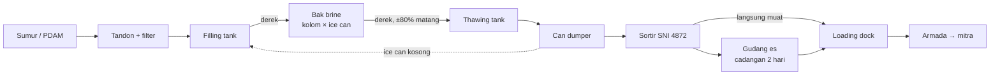
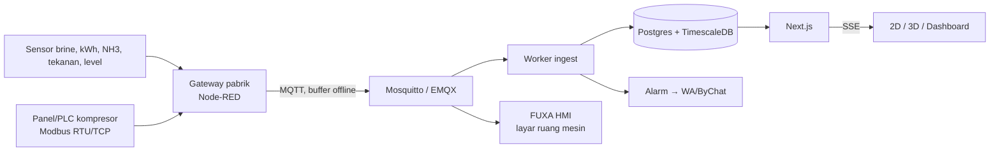
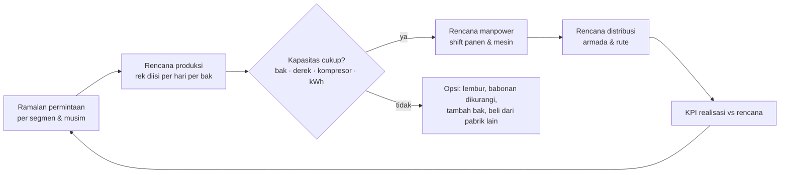

# Riset: Sistem Pabrik Es Balok — Denah 2D/3D, Pra-Produksi, Produksi Realtime, Gudang, Distribusi, Marketing & Manpower

Tanggal: 2026-11-01 (revisi 2, hari yang sama) · Bisnis: Es Balok (PMPersada, PMPakis, menyusul PMPutra)
Melanjutkan: `docs/superpowers/specs/2026-10-25-produksi-es-balok-builder-denah-design.md` (Builder Denah tahap 1)

> **Sumber.**
> - Data teknik pabrik es: **FAO**, *Planning and engineering data 1. Fresh fish handling — 4. Ice plants* (fao.org/4/P3407E/P3407E05.htm). Dibaca langsung pada 2026-11-01.
> - Fakta proses: file riset domain `riset-produksi-es-balok-brine-tank (1).md` dan penjelasan pengguna (memory `es-balok-produksi-knowledge`).
> - Repo dan pustaka: bintang, lisensi, dan aktivitas terakhir diverifikasi lewat GitHub API (`gh api`) dan npm registry pada 2026-11-01.
> - Pencarian topik lewat Bing di browser bawaan: jurnal UNTAG Surabaya (rute distribusi es balok), ULM (strategi usaha pabrik es Batulicin), Kemnaker, PUIL 2020.
>
> **Batasan.**
> - **Pinterest** butuh login, jadi isinya tidak bisa dibaca otomatis. Bagian 14 berisi daftar kata kunci untuk dijelajahi sendiri, atau login di browser bawaan lalu minta saya membacanya.
> - **GitLab** dicari, tetapi tidak ada proyek relevan yang lebih baik daripada di GitHub.
> - **Angka teknik (refrigerasi, listrik, K3)** di dokumen ini adalah patokan perencanaan, bukan desain konstruksi. Wajib dicek engineer refrigerasi amonia dan instalatir listrik bersertifikat.

> **Keputusan pengguna (2026-11-01):** pustaka berlisensi apa pun, termasuk AGPL/GPL, **boleh dipakai**. Pengguna akan memberi kredit, mengurus izin, dan menanggung risiko hukumnya. Pemilihan pustaka di dokumen ini murni berdasarkan kelayakan teknis.
> *Catatan faktual, sekali saja:* inti kewajiban AGPL adalah menyediakan **kode sumber hasil modifikasi** kepada pengguna layanan, bukan sekadar kredit. Bila tidak ingin membuka kode, sebagian besar proyek AGPL menjual lisensi komersial.

---

## 1. Ringkasan jawaban

1. **Satu model pabrik, banyak tampilan.** Builder 2D tetap menjadi editor utama. 3D, skematik pipa (P&ID), diagram listrik satu garis (SLD), peta gudang, dan dashboard semuanya dibentuk dari **data yang sama**.
2. **3D bisa dibuat prosedural**, tanpa memodelkan apa pun secara manual. Inti stack: React Three Fiber 9 + drei + three.js (cocok dengan React 19.2.4 dan Next 16 di proyek ini). Repo yang paling layak dijadikan acuan: **openPlan3D**, **neonplan3d**, dan **aedifex** (editor denah 2D→3D modern), **Open-Industry-Project** (simulator industri three.js di browser), **FUXA** (SCADA/HMI web), dan **realvirtual-WEB** (HMI 3D industri).
3. **Pra-produksi (mesin, pipa, listrik) dimodelkan sebagai lapisan + graf sambungan.** Editornya bisa memakai **draw.io/maxGraph** (sudah punya pustaka simbol listrik & P&ID) atau **React Flow**. Perhitungannya memakai **CoolProp** (sifat amonia) dan **pandapower** (beban listrik).
4. **Produksi realtime** dimulai dari input operator, lalu sensor via Node-RED → MQTT → TimescaleDB → SSE. FUXA bisa langsung dipakai sebagai layar HMI ruang mesin.
5. **Kunci yang menyatukan semua modul adalah S&OP bulanan** (*Sales & Operations Planning*): ramalan penjualan → rencana isi kolom per hari → kebutuhan manpower per shift → rencana armada. Tanpa S&OP, denah, produksi, gudang, distribusi, dan marketing hanya menjadi modul yang terpisah-pisah.
6. **Patokan FAO untuk pabrik es balok di daerah tropis:**
   - Listrik **55–70 kWh/ton**.
   - Luas mesin + bak **±200 m² untuk 20 t/hari**.
   - Tenaga kerja **96 jam-orang/24 jam untuk 20 t/hari** (≈12 orang-shift).
   - Cadangan gudang **2 hari produksi**.

---

## 2. Hierarki aset dan tampilan

### 2.1 Hierarki (mengikuti ISA-95)

```
Grup (holding)
└─ Pabrik / Site            PMPersada, PMPakis, PMPutra
   └─ Area                  Ruang Mesin · Ruang Bak · Water Treatment · Filling · Thawing & Dumper ·
                            Sortir · Gudang Es · Loading Dock · Panel Listrik/Genset · Kantor · Parkir Armada
      └─ Unit kerja         Bak · Kompresor · Kondensor · Derek · Tangki · Panel · Rak gudang
         └─ Sub-unit        Kolom (rek) — satuan penjadwalan
            └─ Item         Ice can — satuan kualitas/kerusakan (bisa diberi QR)
```

### 2.2 Tampilan dari satu model

| Tampilan | Pengguna | Teknologi | Acuan repo |
|---|---|---|---|
| Denah 2D (editor) | Admin/Direktur | SVG (sudah ada) | react-planner, arcada-planner |
| 3D | Direktur, investor, training operator | React Three Fiber | openPlan3D, neonplan3d, aedifex, blueprint3d |
| P&ID pipa | Teknisi mesin | draw.io/maxGraph atau React Flow | IPD-Studio, react-piping-diagram, standar DEXPI |
| SLD listrik | Teknisi listrik | draw.io/maxGraph atau React Flow | QElectroTech (gambar formal) |
| HMI ruang mesin | Operator mesin | FUXA atau SVG sendiri | FUXA, webtopo-vue3 |
| Peta gudang | Admin gudang | SVG/3D | GreaterWMS, InvenTree, warehouse-3d |
| Dashboard/BI | Manajemen | Recharts (sudah ada), Superset/Metabase | – |

---

## 3. Patokan teknik pabrik es balok (FAO)

| Parameter | Nilai FAO | Catatan untuk PMP |
|---|---|---|
| Prinsip | Can bentuk tirus berisi air direndam di brine. Setelah beku, can dicelup air untuk melepas balok, lalu balok disimpan di cold room dan dipecah sesuai permintaan | Sama dengan PMPersada/PMPakis |
| Suhu brine | ±−5 °C (FAO); file riset lain menyebut −9 s/d −15 °C | Perlu diukur di lapangan. Ini sensor pertama yang paling berguna |
| Waktu beku | 16–24 jam (*rapid-block* hanya beberapa jam) | Sesuai data lama: Kecil 24 jam, Besar 32 jam |
| Ukuran blok | 25 kg (panjang 1.025–1.105 mm); 50 kg (408×184 mm atas, panjang 1.000 mm); 136 kg (560×280, panjang 1.220 mm) | Pakai sebagai *preset* ukuran ice can di builder |
| Luas mesin + bak (tanpa gudang, kantor, gardu, kondensor) | 10 t → 100 m² · 20 t → 200 m² · 50 t → 450 m² · 100 t → 800 m² | Validasi kasar di builder: "luas bak & mesin wajar untuk kapasitas X?" |
| Listrik (tropis, hanya ice-maker + refrigerasi) | Block **55–70 kWh/t** (flake 70–85, tube/plate 60–75) | KPI kWh/ton: di atas 70 = tanda masalah (brine, isolasi, kondensor) |
| Air kondensor | Evaporatif/cooling tower **0,25–0,5 t air per t es**. Shell & tube sekali-buang 15–125 t/t (tergantung suhu air) | Masuk perhitungan kapasitas sumur |
| Air bahan es | Sedikit di atas berat es (ada *bleed* & susut). Harus standar air minum | – |
| Gudang | Block dirancang dengan **cadangan 2 hari** produksi | Ukuran gudang es = 2 × produksi harian (batang) |
| Mesin di atas gudang | Tidak lazim untuk block karena bebannya terlalu berat | Tata letak block selalu horizontal, satu lantai |

### 3.1 Estimasi beban refrigerasi (rumus untuk kalkulator di aplikasi)

Panas yang dibuang per kg es (air 30 °C → es −5 °C):
`4,19 × 30 (pendinginan air) + 334 (beku) + 2,1 × 5 (subcool es) ≈ 470 kJ/kg`

Untuk 1 t/hari: 470 MJ ÷ 86.400 s ≈ **5,4 kW**. Setelah ditambah faktor rugi-rugi (isolasi bak, agitator, thawing, margin) ×1,4–1,6, hasilnya **±8–9 kW refrigerasi per ton/hari (≈2,3–2,5 TR)**. Dengan COP amonia ±3, kebutuhannya ±3 kW listrik × 24 jam ≈ 70 kWh/t. Angka ini **konsisten dengan patokan FAO**. Ini perkiraan kasar untuk perencanaan saja. Hitungan sifat amonia yang presisi bisa memakai **CoolProp** (MIT).

---

## 4. Tata letak & alur produksi (flow production)

### 4.1 Alur material



### 4.2 Prinsip tata letak

- **Alur satu arah:** bahan masuk dari satu sisi, es keluar ke loading dock di sisi lain. Jalur garam, amonia, dan solar tidak boleh memotong jalur es.
- **Derek adalah *bottleneck*:** satu jalur rel melayani filling → bak → thawing → dumper. Kapasitas harian = jumlah rek yang bisa dipanen dan diisi ulang oleh derek dalam jam kerja.
- **Ruang mesin** bersebelahan dengan ruang bak (pipa amonia pendek), terpisah dinding, dilengkapi ventilasi + detektor NH3, dan punya pintu keluar langsung ke luar.
- **Kondensor evaporatif / cooling tower** berada di luar gedung, dekat ruang mesin dan sumber air.
- **Gardu/panel + genset** berada di ruang terpisah, sedekat mungkin dengan kompresor (beban terbesar).
- **Gudang es** menempel ke sortir dan dock. Pintunya diberi tirai plastik/air curtain untuk menekan susut leleh.

### 4.3 Metode analisis alur yang dipakai industri

| Metode | Gunanya untuk es balok | Bisa diwujudkan sebagai |
|---|---|---|
| **Value Stream Mapping (VSM)** | Memetakan waktu tiap tahap (isi → beku → panen → sortir → muat) dan antreannya | Diagram VSM otomatis dari data event operator |
| **Takt time** | `jam kerja derek ÷ jumlah rek yang harus dipanen/hari` → tempo panen per rek | Angka target di layar operator |
| **Little's Law** | `stok gudang = laju keluar × lama tinggal`, untuk mengukur umur es di gudang | KPI "umur rata-rata es di gudang (jam)" |
| **Simulasi diskrit** | "Bagaimana jika tambah 1 bak / ganti derek / ubah jadwal panen?" | JaamSim (Apache-2.0, ada tampilan 3D), salabim (Python, animasi), OFact (Apache-2.0, digital twin material flow), Open-Industry-Project (MIT, three.js, simulasi di browser) |
| **Penjadwalan optimal** | Urutan panen rek + jadwal shift + rute truk dalam satu solver | **Timefold Solver** (Apache-2.0, 1,8rb⭐): penjadwalan, rostering, VRP |

---

## 5. Pra-produksi: mesin, pipa, kelistrikan, engineering

### 5.1 Inventaris yang menjadi data

| Kelompok | Elemen | Data per elemen |
|---|---|---|
| Refrigerasi NH3 | Kompresor, kondensor/cooling tower, receiver, separator, katup ekspansi, evaporator/koil di bak, agitator, blower | Merk, kapasitas (kW/TR), daya motor, jam operasi, tekanan kerja, jadwal servis |
| Pipa | NH3 cair, NH3 gas/suction, air baku, air kondensor, air thawing, drain, udara blower | Fluida (kode warna), diameter, material, sambungan, katup |
| Listrik | PLN/trafo, MDP, SDP per area, genset, ATS, kabel/tray, motor | kVA/kW, arus nominal, proteksi, panel induk |
| Air | Sumur, pompa, tandon, filter, filling, thawing | m³, debit, hasil uji air terakhir |
| Sensor | Suhu & salinitas brine, tekanan suction/discharge, kWh kompresor, ppm NH3, level tandon, suhu gudang | Tag, satuan, ambang alarm |
| K3 | Detektor NH3, exhaust darurat, eyewash/shower, APAR, jalur evakuasi, titik kumpul | Lokasi, tanggal inspeksi |

### 5.2 Kelistrikan

- **Acuan Indonesia:** PUIL 2020 (SNI 0225:2020, bagian 1 & 2). Gambar SLD + daftar beban + perhitungan kabel/proteksi adalah dokumen wajib instalasi.
- **Tool:**

| Kebutuhan | Pilihan | Lisensi / status |
|---|---|---|
| Gambar SLD/wiring formal (desktop) | **QElectroTech** | GPL-2.0 · 604⭐ · aktif 2026-11-01 |
| Editor SLD/P&ID di dalam aplikasi web | **draw.io** (`jgraph/drawio`, bisa di-embed, sudah punya shape listrik & P&ID) atau **maxGraph** (pustaka TS penerusnya) | Apache-2.0 · 9,1rb⭐ / 1,2rb⭐ |
| Editor berbasis graf React | **React Flow** (`@xyflow/react` 12.12.0) | MIT · 38,9rb⭐ |
| Diagram SVG kaya fitur | JointJS | MPL-2.0 · 5,4rb⭐ |
| Perhitungan beban, jatuh tegangan, hubung singkat | **pandapower** (Python) | BSD-3 · 1,3rb⭐ |

- **Fitur aplikasi yang bernilai:** neraca daya per panel (kW terpasang vs kapasitas trafo/genset), peringatan bila menambah kompresor melebihi kapasitas, dan biaya listrik per ton dari kWh meter.

### 5.3 Pipa & refrigerasi

| Kebutuhan | Pilihan | Status |
|---|---|---|
| Standar pertukaran data P&ID | **DEXPI** (pyDEXPI) | AGPL-3.0 · 241⭐ |
| Editor P&ID web (acuan) | IPD-Studio (ISA-5.1, editor P&ID + simulator HMI), react-piping-diagram (React Flow) | Kecil, layak dipelajari |
| Sifat termodinamika NH3/air/brine | **CoolProp** | MIT · 1,1rb⭐ |
| 3D/BIM bila ada gambar konsultan | FreeCAD (LGPL, 35rb⭐), IfcOpenShell (LGPL, 2,9rb⭐), That Open Engine (MIT) | Opsional |

### 5.4 K3 amonia

- **Acuan:** Permenaker No. 5/2018 tentang K3 Lingkungan Kerja, yang memuat Nilai Ambang Batas zat kimia termasuk amonia (perlu dicek nilai terbarunya).
- **Fitur aplikasi:**
  - Ambang alarm detektor NH3 dua tingkat (peringatan / evakuasi).
  - Peta jalur evakuasi di 3D.
  - Checklist inspeksi berkala.
  - Log kebocoran dan top-up amonia (juga KPI biaya).

### 5.5 Maintenance (CMMS)

- Registri aset + jadwal servis preventif (jam operasi kompresor, ganti oli, cek kondensor) + work order + riwayat can rusak.
- **Acuan:** **Atlas CMMS** (`Grashjs/cmms`, AGPL-3.0, 852⭐, web + mobile, aktif). Bisa dipakai langsung, atau polanya dibangun ulang di dashboard.

---

## 6. Teknologi 3D & floor plan builder

### 6.1 Pustaka inti (npm, diverifikasi)

| Paket | Versi | Lisensi | Peran |
|---|---|---|---|
| `three` | 0.187.0 | MIT | Engine |
| `@react-three/fiber` | 9.8.2 (peer react ≥19 <19.4 ✓) | MIT | React renderer |
| `@react-three/drei` | 10.7.9 | MIT | Kontrol kamera, label HTML, instancing, dll. |
| `@react-three/postprocessing` | 3.2.2 | MIT | Outline/sorot objek |
| `@react-three/rapier` | 2.2.0 | – | Fisika (simulasi derek/benturan, opsional) |
| `three-mesh-bvh` | 0.9.17 | MIT | Klik/raycast cepat |
| `camera-controls` | 3.1.2 | MIT | Navigasi kamera |
| `@thatopen/components` / `web-ifc` | 3.6.0 / 0.0.78 | MIT / MPL-2.0 | Bila menerima file IFC/BIM |
| `@xeokit/xeokit-sdk` | 2.6.114 | AGPL-3.0 | Penampil BIM sangat cepat untuk model besar |

### 6.2 Repo acuan floor plan builder & 3D industri

| Repo | ⭐ · lisensi · aktif | Yang diambil |
|---|---|---|
| **laanlabs/openPlan3D** | 263 · MIT · 2026-10 | Editor denah 2D/3D (SvelteKit + three.js). Konsep paling dekat dengan builder kita |
| **Mastershort/neonplan3d** | 972 · MIT · 2026-11 | Denah 3D + editor bawaan + **overlay status perangkat live** (Home Assistant), persis pola "denah 3D + sensor" |
| **TangSY/aedifex** | 91 · MIT · 2026-10 | Editor arsitektur 3D (dinding, pintu, jendela) + asisten AI desain |
| **egmalt/house-planner** | 348 · 2026-10 | Denah skala nyata + 3D + **lapisan listrik, air, saluran, perhitungan, dan BOM berharga**. Paling dekat dengan "pra-produksi" |
| cvdlab/react-planner | 1,5rb · MIT · 2024 | Editor 2D + 3D dari satu model (React) |
| furnishup/blueprint3d | 2,0rb · MIT · 2021 | Teknik ekstrusi denah menjadi ruang 3D |
| fedepaj/arcada-planner | 12 · MIT · 2026 | Editor 2D, multi-lantai, cetak |
| **Open-Industry-Project** | 94 · MIT · 2026-10 | **Simulator otomasi industri di browser** (three.js + fisika Jolt): conveyor, sensor, PLC. Acuan untuk simulasi derek & ice can |
| **game4automation/realvirtual-WEB** | 171 · AGPL-3.0 · 2026-10 | HMI 3D industri berbasis three.js: status mesin & sinyal live di model 3D |
| sakibcoolz/3d-scada-sdk | 0 · MIT · 2026-10 | SDK SCADA 3D (R3F) editor + viewer. Kecil, tetapi stack-nya sama persis dengan kita |
| ertis-research/OpenTwins | 283 · Apache-2.0 | Platform digital twin komposit (Ditto + Grafana + 3D) |
| hookex/warehouse-3d, Xxcool/smart-warehouse | kecil · MIT | Visualisasi rak gudang 3D |

### 6.3 Teknik penggambaran 3D (prosedural dari denah)

| Benda | Cara |
|---|---|
| Lantai & dinding | `ExtrudeGeometry` dari elemen dinding, tinggi dari `tinggiM` |
| Bak | Box berongga + permukaan brine transparan, warna mengikuti suhu |
| Kolom & ice can | `InstancedMesh` (ribuan can, satu draw call). Warna = tahap kematangan, abu = nonaktif/rusak, kuning = Babonan |
| Derek | Rel + troli animasi mengikuti event panen |
| Pipa | `TubeGeometry` di sepanjang polyline siku, warna per fluida, aliran dianimasikan saat pompa ON |
| Kabel tray, panel | Box di elevasi plafon, toggle per lapisan |
| Sensor | Ikon + label `<Html>` nilai live, merah saat alarm |
| Kamera | `CameraControls`. Tombol "tampak atas" = kembali ke 2D |
| Performa | `three-mesh-bvh`, `frameloop="demand"`, dimuat via `next/dynamic` |

3D **read-only** pada tahap awal. Pengeditan tetap di builder 2D.

---

## 7. Perubahan model data denah (`skemaVersi: 2`)

```ts
interface DenahDokumenV2 {
  skemaVersi: 2;
  kanvas: { lebar; tinggi; ukuranGrid; meterPerGrid: number };    // skala nyata
  lapisan: LapisanDef[];   // arsitektur | proses | refrigerasi | pipa-air | listrik | sensor | k3 | gudang
  elemen: DenahElemen[];
  sambungan: Sambungan[];  // graf port A → port B (dasar P&ID & SLD)
}
interface ElemenDasarV2 extends ElemenDasar {
  lapisanId: string; elevasiM?: number; tinggiM?: number; modelGlb?: string; asetId?: string;
}
// Tipe baru: pipa, kabel, panel, tangki, sensor, gudang (dengan slot/rak), dock, kondensor
```

Aturan tahap 1 tetap berlaku: ID stabil, optimistic locking, dan kolom berisi es tidak boleh diubah. Sensor yang sudah punya riwayat hanya ditandai nonaktif, tidak dihapus.

---

## 8. Produksi realtime

### 8.1 Tingkat digital twin

| Tingkat | Isi |
|---|---|
| L1 *Digital model* | 3D statis + data aset |
| L2 *Digital shadow* | 3D + data live (operator & sensor) + alarm |
| L3 *Digital twin* | Simulasi & optimasi: jadwal panen, antrean derek, kWh/ton, "bagaimana jika" |

### 8.2 Input operator (dimulai sekarang)

Event per kolom: `isi` → `blower on/off` → `panen` → `kosong`, ditambah `can rusak`, `babonan`, `nonaktif`. Kematangan dihitung dari waktu berjalan dibanding durasi beku varian, lalu dikoreksi suhu brine bila sensor sudah ada. Data disimpan ke `produksi_kolom_isi`, yang sudah dibuat di tahap 1.

### 8.3 Arsitektur sensor



| Komponen | Pilihan | Status |
|---|---|---|
| Gateway | **Node-RED** | Apache-2.0 · 23,8rb⭐ |
| HMI/SCADA web siap pakai | **FUXA** (editor layar SVG, Modbus/OPC-UA/MQTT bawaan) | MIT · 5,2rb⭐ · aktif 2026-11-01 |
| Broker | Mosquitto (1 pabrik) / EMQX (16,9rb⭐) / TBMQ (Apache-2.0) | – |
| Time-series | **TimescaleDB** (ekstensi Postgres, sejalan dengan `getPgPool()`) atau Apache IoTDB | 23,8rb⭐ / 6,4rb⭐ |
| Platform all-in-one | ThingsBoard (22,6rb⭐) + ThingsBoard Gateway (Modbus, OPC-UA, BLE, …) | Alternatif bila tidak ingin membangun ingest sendiri |
| Panel engineering | Grafana (77,6rb⭐) | Bisa di-embed |
| Twin framework | Eclipse Ditto (EPL-2.0) / OpenTwins (Apache-2.0) | Untuk L3 |
| Protokol | Modbus (umum di panel lokal), OPC-UA (`open62541`, MPL-2.0) | Tergantung merk panel |
| Klien MQTT Node | `mqtt` 5.16.1 | MIT |

---

## 9. Gudang es (WMS)

Gudang es balok lebih sederhana daripada WMS umum, tetapi punya keunikan: **produk menyusut (leleh)**, harus **FIFO ketat**, dan bergantung pada **suhu ruang**.

| Fitur | Penjelasan |
|---|---|
| Ledger stok per varian | Masuk dari event panen (lolos sortir), keluar ke DO/muat, penyesuaian susut/pecah |
| Lokasi/slot | Gudang dipetakan sebagai slot/rak di denah (lapisan gudang), dengan kapasitas batang per slot |
| FIFO & umur stok | Setiap masukan bercap waktu panen, lalu ditampilkan sebagai umur es per slot (jam) |
| Susut | Selisih stok tercatat vs hitung fisik → % susut per hari, dikorelasikan dengan suhu gudang |
| Kapasitas | Patokan FAO: gudang block = **2 hari produksi** |
| Scanner/PWA | Tablet di dock: muat X batang ke truk Y, terhubung ke DO |
| Ice can sebagai aset | QR per rak/kolom → riwayat kerusakan & umur can |

**Acuan open-source (terverifikasi):**

| Repo | ⭐ · lisensi | Yang dipelajari |
|---|---|---|
| **InvenTree** | 7,8rb · MIT · aktif 2026-11-01 | Model stok, lokasi bertingkat, ledger pergerakan, API & aplikasi scanner |
| **GreaterWMS** | 4,4rb · Apache-2.0 · aktif 2026-10 | WMS lengkap (dipakai untuk logistik after-sales Ford Asia Pasifik) |
| ModernWMS | 1,8rb · Apache-2.0 · 2025 | WMS sederhana (Vue) |
| OpenWMS | 756 · Apache-2.0 | Arsitektur WMS + WCS (kontrol peralatan) |
| simple-wms | 0 · MIT · 2026-10 | Scanner PWA + satu API (ide UI dock) |
| Odoo Inventory / ERPNext Stock | 55rb / 40,8rb | Pola bisnis stok penuh |

Rekomendasi: bangun **ledger stok es kecil di dashboard**, dengan pola data meniru InvenTree. Tidak perlu memasang WMS terpisah, karena DO/SI sudah ada.

---

## 10. Distribusi & penjualan

```
kolom_isi ─panen─▶ panen (lolos/gagal sortir) ─▶ stok gudang ─▶ DO/muat ─▶ SI ─▶ piutang & pelunasan
                                                              └▶ Papan Pengiriman · Validasi Rute · GPS armada
```

| Kebutuhan | Pilihan | Status |
|---|---|---|
| Optimasi rute | **VROOM** + **OSRM** (self-host), atau **Timefold** (VRP + jadwal + shift dalam satu solver) | BSD-2 / BSD-2 / Apache-2.0 |
| Routing API lengkap | openrouteservice | GPL-3.0 · 2rb⭐ |
| GPS armada | **Traccar** (200+ protokol GPS tracker) | Apache-2.0 · 8rb⭐ |
| Platform logistik lengkap | Fleetbase (order, driver app, armada) | AGPL-3.0 · 4,5rb⭐ |
| Peta | `maplibre-gl` 6.16.0 (BSD-3), `deck.gl` 9.4.1 (MIT) | – |

Referensi lokal: jurnal UNTAG Surabaya, *Penentuan Rute Distribusi Pengiriman Es Balok* (pabrik yang memasok distributor dan agen tetap). Masalah ini identik dengan VRP.

---

## 11. Marketing

### 11.1 Segmen & perilaku (dari riset domain + jurnal lokal)

| Segmen | Pola beli | Pola bayar | Pendorong |
|---|---|---|---|
| Nelayan / kapal di TPI | Per batang, harian, mengikuti musim ikan | Tunai / "buku utang" setelah melaut | Musim tangkap, cuaca, BBM |
| Pengecer / agen es | Volume besar, rutin | Tempo 7–30 hari | Margin, ketepatan kirim |
| Pasar (ikan, buah, daging) | Harian, pagi | Tunai/tempo pendek | Jam kirim pagi |
| Cold storage / pengolahan ikan | Kontrak, per ton | Tempo 30–60 hari | Konsistensi pasokan, mutu SNI 4872 |
| F&B / minuman / RPH / konstruksi | Musiman (kemarau, Ramadan, hajatan) | Bervariasi | Musim panas, hari besar |

### 11.2 Kerangka yang disarankan

1. **Geomarketing:** petakan titik permintaan (TPI, pasar, cold storage) dibanding pin Mitra Es Balok yang sudah ada. Area permintaan tanpa mitra = target akuisisi. Radius layanan dihitung dari waktu tempuh truk sebelum es menyusut berlebihan.
2. **Peramalan permintaan musiman:** rata-rata per hari-dalam-minggu × faktor bulan (musim ikan, kemarau, Ramadan). Hasilnya menjadi masukan S&OP (bagian 13).
3. **Retensi mitra:** frekuensi order, recency, nilai (RFM), mitra "tidur" > N hari → tugas kunjungan sales. Pola NOO dan Kinerja Karyawan dari MKEsindo bisa dipakai ulang.
4. **Harga & promo:** harga per batang/ton per segmen, diskon volume, harga musiman. Pantau margin per batang (biaya listrik + garam + amonia + tenaga kerja + kirim).
5. **Kanal:** WhatsApp (integrasi ByChat sudah ada) untuk broadcast stok/harga, pengingat tagihan, dan pesanan ulang.
6. **Studi lokal yang layak dibaca utuh:** ULM, *Analisis Strategi Pengembangan Usaha Pabrik Es Balok di sekitar Pelabuhan Perikanan Batulicin*; Ubaya, *Perancangan Strategi Bisnis dan Pemasaran* (pabrik es pantura dekat TPI); serta studi kelayakan pabrik es Kawal, Bintan (Scribd).

| Tool | Pilihan | Status |
|---|---|---|
| CRM | **Twenty** (alternatif Salesforce, React/TS) | 60,2rb⭐ · aktif |
| Otomasi marketing | Mautic | 10,9rb⭐ |
| BI | **Apache Superset** (Apache-2.0, 75rb⭐) / Metabase (50rb⭐) | – |

Rekomendasi: CRM ringan cukup di dashboard (mitra, kunjungan, pipeline prospek), karena data mitra/SI/piutang sudah ada di sana. Twenty layak dijadikan acuan UX.

---

## 12. Manpower planning

### 12.1 Patokan FAO: jam-orang per 24 jam untuk pabrik block (panen kontinu, es tersedia 24 jam)

| Kapasitas | Manajer | Admin | Mesin/maintenance | Panen + simpan + keluar | **Total** | ≈ orang-shift 8 jam |
|---|---|---|---|---|---|---|
| 10 t/hari | 8 | – | 24 | 24 | **56** | 7 |
| 20 t/hari | 8 | 8 | 32 | 48 | **96** | 12 |
| 50 t/hari | 8 | 8 | 48 | 72 | **136** | 17 |
| 100 t/hari | 8 | 12 | 56 | 96 | **172** | 21,5 |
| 200 t/hari | 8 | 12 | 56 | 112 | **188** | 23,5 |

Tabel ini belum termasuk sopir, kenek, sales/kolektor, dan keamanan. Pabrik otomatis (flake/tube) hanya butuh ±40–96 jam-orang. Selisih ini adalah biaya tenaga kerja khas es balok.

### 12.2 Rumus perencanaan

- **Kebutuhan FTE** = jam-orang per hari ÷ jam efektif per orang per hari, lalu × faktor cadangan (cuti/sakit, ±1,1–1,2).
- **Posisi 24/7** (operator mesin): 168 jam/minggu ÷ 40 jam/minggu ≈ **4,2 orang per posisi**. Batas 40 jam/minggu mengikuti UU Ketenagakerjaan jo. Cipta Kerja (7 jam × 6 hari atau 8 jam × 5 hari).
- **Panen** mengikuti jadwal rek matang (takt), bukan jam tetap. Jadwal shift tim panen sebaiknya diturunkan dari jadwal panen.

### 12.3 Peran baku pabrik es balok

Kepala produksi · operator mesin/ruang mesin (24/7) · operator derek & panen · pengisi & sortir · admin gudang/dock · teknisi listrik-mesin · sopir & kenek · sales/kolektor · admin keuangan · keamanan.

| Tool | Pilihan | Status |
|---|---|---|
| Rostering otomatis | **Timefold Solver** (shift, skill, batas jam, libur) | Apache-2.0 · 1,8rb⭐ |
| HRIS/payroll | Frappe HRMS (GPL-3.0, 9rb⭐), OrangeHRM (GPL-3.0) | Integrasi Greator HRIS masih terblokir, jadi ini alternatif |
| Penjadwalan produksi + orang + mesin | orkyo-community (AGPL-3.0, kecil, 2026-10) | Acuan |

---

## 13. Pengikat semua modul: S&OP bulanan



Dengan S&OP, denah (kapasitas), produksi (realisasi), gudang (stok), distribusi (armada), marketing (ramalan), dan manpower (shift) saling mengunci dalam satu siklus.

---

## 14. Riset visual Pinterest (perlu login)

Pinterest tidak bisa dibaca tanpa login. Kata kunci yang disarankan untuk mencari inspirasi visual:

- `ice plant layout`, `block ice plant`, `ammonia refrigeration plant room`
- `isometric factory illustration`, `digital twin dashboard UI`, `SCADA HMI dashboard design`, `3D factory floor plan`
- `warehouse management system dashboard`, `cold storage layout`
- `single line diagram electrical`, `P&ID diagram`, `piping isometric drawing`
- `value stream map`, `production flow layout lean`
- `manpower planning dashboard`, `shift roster UI`, `sales territory map dashboard`

Bila Anda login Pinterest di browser bawaan aplikasi ini, saya bisa membaca papan/pin yang terbuka lalu merangkumnya menjadi arahan desain.

---

## 15. Roadmap

| Tahap | Isi | Dependensi baru |
|---|---|---|
| 1 ✅ | Builder Denah 2D | – |
| 2 | Skema v2: meter, elevasi, lapisan, sambungan, tipe baru; preset ukuran ice can (FAO); validasi luas vs kapasitas | – |
| 3 | **Tampilan 3D read-only** + toggle lapisan | three, R3F, drei |
| 4 | Aplikasi operator (isi/blower/panen/rusak/babonan) + kematangan live 2D/3D | – (SSE yang ada) |
| 5 | Ledger stok gudang es + dock PWA → DO | – |
| 6 | P&ID & SLD dari graf sambungan + neraca daya | draw.io/maxGraph atau React Flow |
| 7 | Registri aset + maintenance (CMMS) + K3 checklist | (acuan Atlas CMMS) |
| 8 | Sensor & HMI: Node-RED, MQTT, TimescaleDB, FUXA, alarm WA (pilot 1 bak) | Node-RED, Mosquitto, `mqtt`, TimescaleDB, FUXA |
| 9 | S&OP: ramalan, rencana produksi, rostering, rencana armada | Timefold |
| 10 | Marketing: geomarketing, RFM mitra, CRM ringan | – |
| 11 | Simulasi & optimasi (L3): derek, kapasitas, rute | JaamSim/salabim/OFact, VROOM/OSRM |

---

## 16. Yang perlu dikonfirmasi pengguna

1. Dimensi nyata gedung & bak (meter) per pabrik. Apakah ada gambar teknik/CAD/foto?
2. 3D prosedural sudah cukup, atau perlu model realistis (GLB)?
3. Merk panel kompresor: apakah ada Modbus/RS-485?
4. Anggaran pilot sensor 1 bak.
5. Apakah gudang es dicatat sebagai stok, atau es selalu langsung dimuat?
6. Kapasitas nyata harian (ton atau batang) per pabrik dan jumlah karyawan sekarang per peran (untuk dibandingkan dengan patokan FAO).
7. Siapa yang menggambar lapisan pipa & listrik: tim internal atau kontraktor?
8. Apakah ingin membuka Pinterest bersama di browser bawaan?
